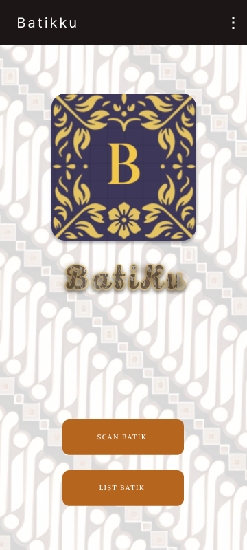

# BatiKu — Batik Pattern Recognition

BatiKu is an Android application that helps users identify traditional Indonesian batik patterns by scanning them with their device's camera. The app compares scanned patterns with images in a stored dataset to find a matching batik motif.

This project was developed as a personal portfolio project, combining Android development with an exploration of digital pattern recognition to support the discovery of Indonesia's cultural heritage.

## Features

- **Camera Scanning** — Capture batik patterns using the device's camera.
- **Pattern Recognition** — Compare scanned patterns against a stored collection of batik images.
- **Batik Identification** — Display the identified batik motif based on the matching process.

## Screenshots

| Home Screen | Camera Scanning |
|:---:|:---:|
|  |  |

| Batik Identification Result |
|:---:|
|  |

## Tech Stack

- **Kotlin** — Primary programming language
- **Android Studio** — Development environment
- **CameraX** — Camera integration
- **Gradle** — Build and dependency management

## How It Works

1. **Scan:** The user scans a batik pattern using the device's camera.
2. **Compare:** The captured pattern is compared with images in the stored batik dataset.
3. **Identify:** The application presents the matching batik motif when a match is found.

The identification process uses the project's stored image dataset. This README does not assume the use of a machine-learning model or an external recognition API.

## Getting Started

### Prerequisites

- Android Studio
- A compatible JDK and Android SDK
- An Android device or emulator with camera support

### Installation

1. Clone the repository:

   ```bash
   git clone https://github.com/Wisnu12/BatiKu.git
   ```

2. Open the cloned project in Android Studio.

3. Wait for Gradle to sync and download the required dependencies.

4. Connect an Android device or launch an emulator.

5. Run the `app` configuration from Android Studio.

6. Grant camera permission when prompted.

## Project Goals

BatiKu explores how mobile applications can make traditional Indonesian batik patterns easier to discover and identify.

The project also demonstrates practical Android development skills, camera integration, and image-based pattern matching.

## Author

Developed by [@Wisnu12](https://github.com/Wisnu12).

## License

No license has been specified for this project. Add a `LICENSE` file if you intend to publish it under an open-source license.
